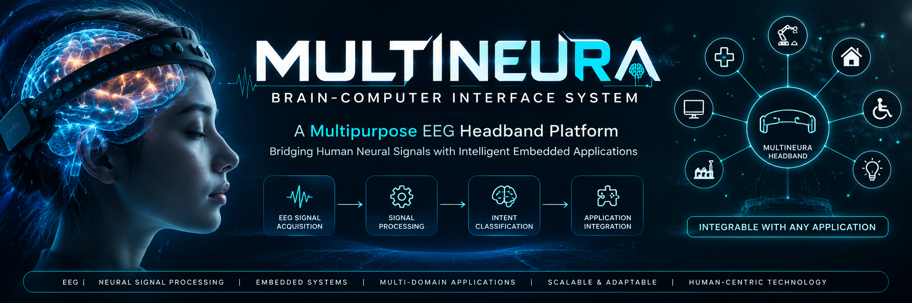

# MULTINEURA – EEG-Based Brain–Computer Interface (BCI)

## About MULTINEURA

**MULTINEURA** is a multipurpose EEG-based Brain–Computer Interface (BCI) headband platform designed to acquire and interpret human neural signals and translate them into actionable commands.

The core vision is to develop a flexible neural interface that can be integrated with diverse external applications across multiple domains. Rather than being restricted to a single use case, MULTINEURA aims to provide a common BCI platform that can adapt to different application requirements.

The headband acts as the central interface, while application-specific hardware and software modules enable integration with different systems.

**One Headband. Multiple Applications. Unlimited Possibilities.**

**Current development status:** This repository contains a MATLAB/Simulink R2018 model-builder script using synthetic EEG-like signals and demonstration decision logic. It is an early-stage simulation, not a validated P300 detector or operational BCI system.

**Current status:** This repository contains a MATLAB/Simulink R2018 model-builder script using synthetic EEG-like signals and demonstration decision logic. It is not a validated P300 detector, clinical device, or operational security/emergency system.

## Applications explored

1. **Neural Smart Lock:** BCI-based selection of an access request. A real deployment must use separate identity verification and authorization; EEG command selection is not identity proof.
2. **Neural Assistive Emergency Alert:** BCI-based selection of an emergency command. A conventional backup alert method must remain available.

## Architecture

              MULTINEURA EEG HEADBAND
                         |
                         v
                 EEG Signal Acquisition
                         |
                         v
                  Signal Conditioning
                         |
                         v
                 Feature Extraction
                         |
                         v
                Intent Classification
                         |
                         v
                  Command Generation
                         |
                         v
               APPLICATION INTERFACE
                         |
          +--------------+--------------+
          |              |              |
          v              v              v
     Application 1  Application 2  Application 3
          |              |              |
          v              v              v
     Smart Lock    Emergency Alert   Future
                                      Integrations

## Repository structure
MULTINEURA-EEG-BCI-System/
│
├── README.md
├── banner.png
├── .gitignore
├── MULTINEURA_Build_R2018.m
└── DEVELOPMENT_ROADMAP.md

## Requirements

- MATLAB R2018
- Simulink compatible with MATLAB R2018

The builder script uses standard Simulink blocks and does not intentionally require additional toolboxes. Block availability may vary by installation.

## Run the simulation

1. Download or clone this repository.
2. Open MATLAB R2018.
3. Set the Current Folder to the repository's `model` directory.
4. Open `MULTINEURA_Build_R2018.m` and click **Run**.
5. The script is intended to create and open `MULTINEURA.slx`.
6. Run the model and open its Scope blocks.

The `.slx` model is generated locally by MATLAB. It is not included until it has been generated and verified.

## Included in the current simulation

- Synthetic EEG-like signal generation and simulated noise
- Basic signal conditioning and smoothing
- Demonstration threshold decision
- Demonstration command selector
- Separate smart-lock and emergency-alert logic outputs
- Scope and Display monitoring

## Not implemented yet

- Real EEG electrode/amplifier acquisition
- Visual P300 stimuli and synchronized event markers
- Real P300 epoch extraction and averaging
- Feature extraction validated on labelled EEG recordings
- Trained and evaluated LDA classifier
- ESP32 communication and physical outputs
- Safety, security, usability or clinical validation

## Safety

- Never connect scalp electrodes directly to an Arduino or ESP32 ADC.
- Use an appropriate EEG acquisition device with suitable isolation and electrical safety.
- Do not connect this prototype to a real door lock or rely on it as a security system.
- Keep an independent conventional emergency alert method available.
- This prototype is not for medical diagnosis or treatment.

See [`docs/DEVELOPMENT_ROADMAP.md`](docs/DEVELOPMENT_ROADMAP.md) for planned work.

## Contributions

For suggestions, open a GitHub Issue. Clearly distinguish simulated results from experiments using real EEG data.

## Copyright and Intellectual Property Notice

© 2026 MULTINEURA Project. All Rights Reserved.

MULTINEURA is an original project concept and ongoing development initiative.

This repository is published solely for viewing, academic evaluation, demonstration and informational purposes.

No permission is granted to copy, reproduce, modify, distribute, commercially exploit or develop derivative works from the project's original materials without prior written permission from the project owner.

Viewing this repository does not grant any ownership or intellectual property rights.

For permission or collaboration enquiries, please contact the project owner.
